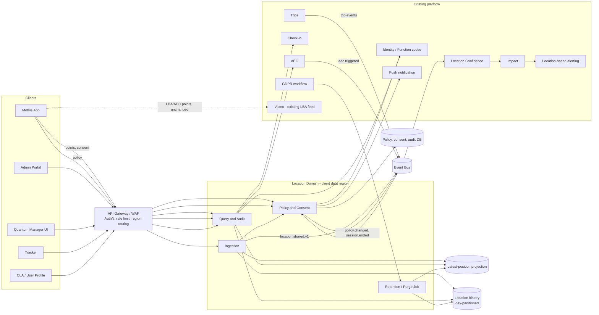
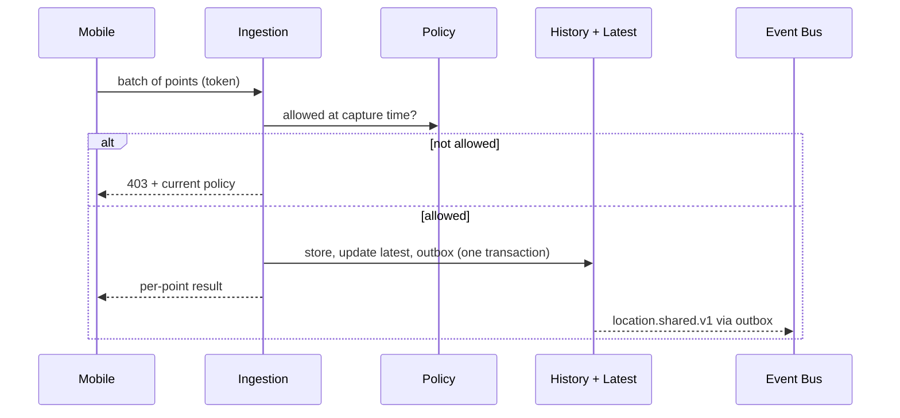
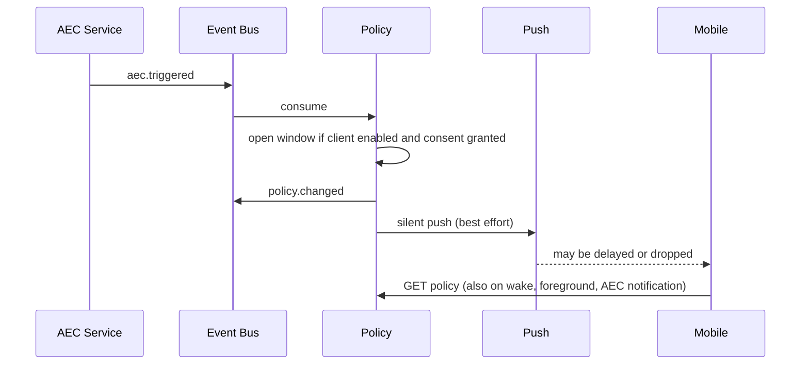

# Live Location Sharing – Backend Architecture (HLD)
| | |
|---|---|
| **Audience** | Architecture Review Board |
| **Status** | Draft for review (v0.3, responds to Architecture review of v0.2) |
| **Tickets** | Epic [SX-76](https://internationalsos.atlassian.net/browse/SX-76); stories [SUB-5675](https://internationalsos.atlassian.net/browse/SUB-5675) (read), SUB-5354, SUB-5652 (not read); sub-tasks SUB-5362, SUB-5363, SUB-5364, SUB-5365, SUB-5366, SUB-5371, SUB-5411 |
| **Published copy** | [Confluence](https://internationalsos.atlassian.net/wiki/spaces/H3SProd/pages/6905462863/Live+Location+Sharing+Backend+Architecture+Proposal) |

> Items marked **[Assumption]** are not confirmed against existing platform internals and need validation.

## Document map

| Document | Contents |
|---|---|
| [Requirements baseline](./live-location-sharing-requirements.md) | Problem statement, source documents, requirement IDs, conflicts between sources |
| **This HLD** | Context, components, flows, integration boundaries, risks. Statements only; no payloads or columns |
| [LLD](./live-location-sharing-lld.md) | Data model, API contracts, algorithms, event schemas |
| [ADRs](./adr/README.md) | One decision per record, with options and consequences |
| [Review responses](./live-location-sharing-review-responses.md) | Answers to the Architecture team's questions, with owners for what is still open |

---

## 1. Problem statement and scope

### 1.1 Problem

A manager can see a traveller's itinerary and stored address. They cannot see where that person is now unless the person has just checked in. The mobile app already posts location to a vendor (Vismo) for location-based alerts and AEC, but that stream does not feed Location Confidence, gives managers no map, history or replay, and sits outside our consent, retention and audit controls.

The full statement, success measures and requirement IDs are in the [requirements baseline](./live-location-sharing-requirements.md). This HLD answers those requirements and every decision below traces to an ID there.

### 1.2 Scope

| In scope | Out of scope |
|---|---|
| Consent-bound capture from the mobile app, policy and sharing types per client | Continuous or high-frequency GPS, including a faster rate during an advisory |
| Ingestion, storage, retention and purge | Points before consent and OS permission |
| One read API for Quantum and Tracker: map, history, replay | A new alerting engine; deciding who is inside an alert |
| Events to Location Confidence | A dispatcher session, a few-second rate, or a live socket in release 1 |
| Integration with the GDPR workflow | Sending these points to Vismo or Hasura Cloud, or storing them in the check-in tables |
| Counts by client (enable, disable, share) | RFP/deal tagging (stays in CRM) |

Tracker: the backend serves Quantum **and** Tracker through the same API. SUB-5675 lists "Quantum/Tracker" as in scope and "Visibility in Tracker" as out of scope for the initial release ("confirm with team"), so whether Tracker ships a screen is a Product decision (conflict C6 in the requirements). It does not change the API.

Two further differences from SUB-5675 need Product and the owning teams: SUB-5675 feeds "the existing impact engine" whereas this design feeds Location Confidence (C8), and it lists "alerting improvements" in scope whereas this design adds no alerting logic (C9).

---

## 2. Decisions

| # | Decision | ADR | Status |
|---|---|---|---|
| D1 | Build a company-owned Location Service; not Vismo, Amazon Location or a SaaS vendor | [ADR-001](./adr/ADR-001-location-service-build-vs-buy.md) | Accepted |
| D2 | Retention equals the longest queryable range; default 14 days; day-partitioned history | [ADR-002](./adr/ADR-002-retention-and-query-window.md) | Proposed |
| D3 | One low-power capture profile with a minimum spacing; no high-frequency mode | [ADR-003](./adr/ADR-003-capture-strategy.md) | Proposed |
| D4 | Policy enforced server side at ingestion and query; modes, event-window activation and local-time schedule | [ADR-004](./adr/ADR-004-sharing-modes-and-local-time.md) | Proposed |
| D5 | One fence rule for revoke, client disable, client change; OS permission loss suspends, not revokes | [ADR-005](./adr/ADR-005-revoke-disable-and-client-change.md) | Proposed |
| D6 | One event per accepted point to Location Confidence; LBA continuity plan | [ADR-006](./adr/ADR-006-event-integration-and-lba.md) | Proposed |
| D7 | Data stored in the client's data region | [ADR-007](./adr/ADR-007-data-residency.md) | Proposed |
| D8 | Newest allowed point across sharing devices | [ADR-008](./adr/ADR-008-multiple-devices.md) | Proposed |
| D9 | Delta polling for the map first; no Hasura Cloud | [ADR-009](./adr/ADR-009-manager-map-transport.md) | Proposed |
| D10 | Aurora PostgreSQL (`locationDB`) for history and policy; local PostgreSQL for development | [ADR-010](./adr/ADR-010-storage-engine.md) | Accepted |
| D11 | C# on .NET 10 with ASP.NET Core controllers; one deployable with ingestion, policy and query modules | [ADR-011](./adr/ADR-011-implementation-stack.md) | Accepted |

---

## 3. Current state and gaps

What exists today (from the mobile code) and what the new service must add.

| Capability | Current service (Vismo `current/locations`) | Needed | Gap | Closed by |
|---|---|---|---|---|
| Purpose | Feeds LBA and AEC | Manager visibility and Location Confidence evidence | New purpose, separate consent | Policy and consent |
| Identity | Device headers only; no user or client id | Tenant and user from the token | No tenant model | Ingestion API |
| Point contract | lat, long, timestamp, accuracy, device time | Also point id, speed, course, device id, offset | Idempotency and history columns missing | Ingestion API ([LLD 4.1](./live-location-sharing-lld.md)) |
| Consent and policy | A device LBA flag | Versioned consent, client sharing types, server-side enforcement | No consent record we control | Policy service |
| History, replay, map | None seen | Latest, history, replay merged with check-ins and AECs | No read model | Query API |
| Retention and purge | Not controlled by us; vendor capability not verified | Per-client retention, GDPR purge with evidence | No evidence path | Purge job |
| Audit | Not controlled by us | Manager access audit without coordinates | No audit | Query API |
| Residency | Single vendor base URL per environment | Client's data region | Not controllable | ADR-007 |
| Downstream | Vendor alerting only | Events to Location Confidence | No event feed | Outbox and bus |
| Device registry | Exists (device id, OS location services, AEC and LBA flags) | Per-device sharing state | Reuse, extend | Policy service |

---

## 4. Target architecture

### 4.1 Context

The dotted line is the existing LBA/AEC stream, left unchanged in phase 1 (ADR-006).

### 4.2 Components

| Component | Responsibility |
|---|---|
| **Ingestion** | Authenticate, validate, enforce effective policy at capture time, de-duplicate, persist, publish |
| **Policy and consent** | Client sharing types, consent, user preference, event windows, per-device sharing state, policy delivery to devices |
| **Query and audit** | Latest, history and replay with function-code and population-scope authorisation; access audit |
| **Purge job** | Retention, fenced data, erasure through the GDPR workflow, purge evidence |
| **Event bus** | `location.shared.v1`, `location.policy.changed.v1`, `location.session.ended.v1`; consumed `aec.triggered`, trip events |

One deployable with three modules (ingestion, policy, query) plus a separate purge job; background workers handle the inbox, outbox, expiry and erasure. Split the deployable only if write and read profiles diverge.

### 4.3 Deployment and region

Each client's data stays in that client's data region (ADR-007). The gateway routes by client; nothing is replicated across regions for map reads. No cloud vendor, high availability, firewall rules, recovery targets or service identities are fixed here; they need Platform approval.

---

## 5. Key flows

### 5.1 Capture and ingestion

1. The app shows the disclosure, obtains consent and the OS permission, then captures at the low-power profile (ADR-003) and keeps points in an encrypted buffer for up to 48 h.
2. It uploads batches of at most 100 points with the token. Ingestion checks policy **at capture time**, drops duplicates, stores the point, updates the latest projection and writes an outbox row in one transaction.
3. The response tells the device which points were stored or rejected so it can delete its copies. A rejection that means "stop" (`403`) carries the current policy.
4. The outbox publishes `location.shared.v1`.

### 5.2 Event-window activation (AEC or advisory)

Push is an accelerator, not the mechanism; the device re-evaluates on every wake and the server accepts any point captured inside the window (ADR-004). Consent and OS permission are never bypassed.

### 5.3 Manager map

Quantum and Tracker call the Query API. The API resolves the manager's population scope from IAM and returns the people in scope who are sharing now, with name, capture time and age. Only `LOCATION_SHARE` points are returned; check-ins stay in their own feed so the layers remain separate. Polling with delta and ETag (ADR-009).

### 5.4 History and replay

History (table) returns location points. Replay merges location points with check-ins and AECs read from their own stores, ordered by time. Authorisation is by function code and population scope, checked in the API. Every manager read of another user is audited without coordinates. Ranges and caps follow ADR-002.

---

## 6. Policy, consent and lifecycle

- **Sharing types** per client: Always, Schedule, Active Travel, and an event window. The traveller picks one primary type and, for Schedule, sets weekly windows in local time. The event window is additive and needs consent already granted (ADR-004).
- **Consent** is a versioned record per user and client, revocable at any time. Consent and the OS permission are separate; losing the OS permission suspends the device and keeps consent (ADR-005).
- **Ending sharing** (revoke, client disable, logout, client change, erasure) follows one fence rule: nothing captured before the fence is shown again (ADR-005).
- **Permissions:** `MGRLOCHIS` and `USRLOCHIS` function codes, added to the catalogue; map visibility uses existing Quantum map permissions **[Assumption]**. The PRD notes the manager code has two spellings in the stories (open).
- Authorisation is enforced server side at ingestion and query, not only in the UI.

---

## 7. Integrations

| System | Boundary |
|---|---|
| **Location Confidence** | Consumes `location.shared.v1` as live-share evidence and decides the place ("now", 30 min freshness, own signal ledger). Its PRD puts realtime location out of scope, so live-share intake is unplanned work with no owner (ADR-006). Its HLD, LLD and ADR pages are still to be read |
| **Impact** | Assesses the place that Location Confidence decides. No direct dependency on this service |
| **Location-based alerting** | Unchanged. Notifies only where the client already has it. This service never decides who is inside an alert |
| **Vismo (LBA/AEC feed)** | Unchanged now; the product owner plans to retire it once the native service covers what Vismo does, including alert matching and push, which this service does not do (ADR-006 section 4) |
| **GDPR workflow** | Fences, purges every copy and records evidence |
| **Metrics** | Enable, disable and share counts by client with no coordinates; "alerts by location source" needs an alerting-side owner |

---

## 8. Retention, privacy and security

- Retention defaults to 14 days and equals the longest queryable range (ADR-002). Shortening applies at the next purge run; lengthening needs Product and Legal approval.
- Coordinates stay out of logs, audit, analytics and CRM. The audit records who looked, at whom, range and when.
- TLS in transit; encryption at rest with managed keys; tenant and person come from the token; the server re-checks policy before storing a point.
- Erasure clears every copy: store, latest projection, queue, bus, Location Confidence and backups. The mechanism for backups and bus retention is **open** (Platform).
- Abuse: rate limits and payload caps; mock-location and impossible-speed points are stored and flagged and published with the flag.
- Location is highly sensitive personal data: lawful basis per region, a DPIA and versioned disclosure text are required before launch.

---

## 9. Non-functional targets and capacity

Targets are in the [requirements baseline](./live-location-sharing-requirements.md) (NFR-01 to NFR-09). Neither live-location source sets a throughput target. The Location Confidence PRD requires ingestion for at least 500,000 people with 4× spikes, so both scenarios are sized. They are planning assumptions, to be validated by load test.

| Input | Scenario A | Scenario B (Location Confidence PRD scale) |
|---|---|---|
| Users sharing | 100,000 | 500,000 |
| Point rate | One per 5 min on average, bounded by the ADR-003 floor | same |
| Average writes | About 330/s | About 1,670/s |
| Peak writes (5× average; LC also requires 4× spikes) | About 1,700/s | About 8,300/s |
| Points per day | About 29 M | About 144 M |
| Rows retained at 14 days | About 406 M | About 2.0 B |
| Storage (about 150 B per row) | About 60 GB | About 300 GB |

Design scales ingestion horizontally and keeps history partitioned by time so purge cost is constant. Scenario B should drive the load test and the storage engine check (ADR-010).

---

## 10. Risks

| Risk | Impact | Mitigation |
|---|---|---|
| Battery drain | Revocation, churn | Low-power capture, no high-frequency mode, battery measurement before GA |
| iOS heartbeat and distance floor not achievable as specified | Gaps in trails, stale map | Feasibility spike; freshness defined with Product |
| Silent push unreliable | Late activation of event windows | Device-side re-evaluation; measure propagation (ADR-004) |
| LBA starved if Vismo posting stops | Lost alerts | Keep the feed until the new path is proven; retire per app version (ADR-006) |
| Location Confidence treats data older than 30 min as stale; stationary travellers send nothing | Live evidence drops out of the score | Short heartbeat where the OS allows plus a validity rule in Confidence (ADR-006) |
| Location Confidence intake has no owner, and its PRD puts realtime location out of scope | No downstream value | Name owner, story and date before build |
| Scale is 500,000 people in the consumer's PRD, five times the earlier planning figure | Under-sized store and bus | Load test at scenario B (HLD 9) |
| Event copies cross regions | Residency breach | Resolve consumer residency (ADR-007) |
| Released app versions still post only to the vendor | No live data for those users | Minimum app version gate in policy |
| Conflicting requirement sources | Rework | Resolve conflicts C1 to C13 before build |

---

## 11. Delivery plan

| Phase | Content |
|---|---|
| 0 | Resolve conflicts and open questions, event contracts, DPIA kick-off, mobile feasibility spike, platform approval |
| 1 | Policy and consent, function codes, admin config (SUB-5411, 5365, 5366) |
| 2 | Ingestion, history and latest stores, retention and purge (SUB-5363) |
| 3 | Query API: map, history, replay, access audit (SUB-5362, 5371, 5364) |
| 4 | Events to Location Confidence, counts; Tracker screen if confirmed |
| 5 | Hardening: load test, security review, battery measurement, pilot with one client |

Rollout is behind a per-client feature flag with a global kill switch.

---

## 12. Open questions

| # | Question | Owner |
|---|---|---|
| Q1 | Confirm 14 d retention and the 14 d range (SUB-5675 says 30 d retention and 7 d ranges); amend SUB-5363, SUB-5371 and SUB-5364 | Product |
| Q2 | Delete stored data on revoke or disable, or keep until retention? | Legal, Product |
| Q3 | Length of the sharing lease that bounds a remote disable for an offline phone | Product |
| Q4 | Owner, story and date for Location Confidence live-share intake; agree the signal contract and the validity rule (its freshness is 30 min) | Confidence team |
| Q5 | Define the advisory condition and window; AEC and advisory both? | Product |
| Q6 | Traveller-local or client-local schedule hours | Product |
| Q7 | Heartbeat interval (Location Confidence needs at most 30 min or a validity rule) and map freshness target | Product, Mobile |
| Q8 | Is Tracker shipping a screen in this release? Which spelling of the manager permission? | Product, IAM |
| Q9 | Hosting runtime for the .NET 10 service (ADR-011) and cache; bus (Location Confidence depends on Kafka: reuse?); region, HA, DR targets; Aurora PostgreSQL version, instance class and available extensions (ADR-010) | Platform |
| Q10 | Residency of Location Confidence and Impact; maximum retention per region | Security, Legal |
| Q11 | Product and Legal sign-off on the LBA interim (one tracker, two purpose-bound sinks) | Product, Legal |
| Q12 | Availability of a client-change event from IAM | IAM |
| Q13 | Backup and bus erasure mechanism | Platform |
| Q14 | Read the Location Confidence HLD, LLD, data-structure and ADR pages linked from its PRD and align the event contract and ABAC/segmentation model (PRD read; see requirements 3.4) | Architecture |
| Q15 | Hasura admin secrets held in `EXPO_PUBLIC_*` variables | Security, Platform |
| Q16 | Read SUB-5354 and SUB-5652 (likely the app-side stories) and check capture, consent and permission requirements against them | Architecture, Mobile |
| Q17 | Route live location to Location Confidence (this design) or directly to the impact engine (SUB-5675)? Who owns "alerting improvements"? | Product, Impact team, Alerting |
| Q18 | Turn "real time" in SUB-5675 into a freshness target | Product |
