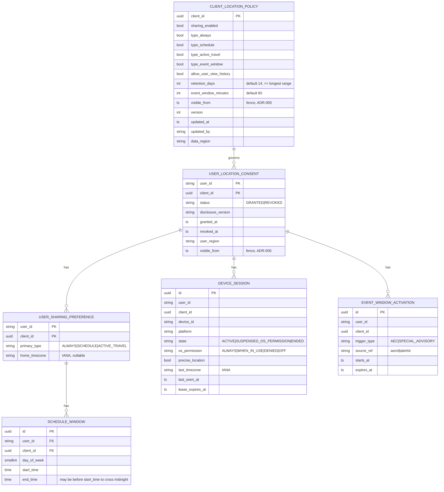
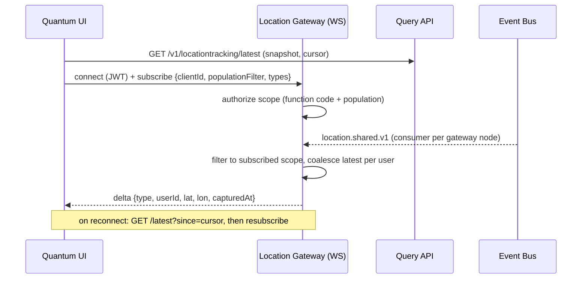

# Live Location Sharing – Low-Level Design
| | |
|---|---|
| **Status** | Draft for review |
| **Audience** | Backend, mobile and Quantum/Tracker developers; reviewers of contracts |
| **Read first** | [Requirements](./live-location-sharing-requirements.md) · [HLD](./live-location-sharing-backend-architecture.md) · [ADRs](./adr/README.md) |

This document holds the detail that the HLD intentionally leaves out: tables, columns, payloads, algorithms and event schemas. Items marked **[Assumption]** need validation. Where a rule comes from a decision, the ADR is cited.

---

## 1. Conventions

- Versioned under `/v1/locationtracking`, JSON, JWT bearer. Tenant (`clientId`) and person (`userId`) come from the token; a body field can never change them.
- Times are UTC ISO-8601. `userId` is the platform **party id**, a string such as `IND_335dc59b-2b6a-4fa9-976f-d0c2b3d0647f` (a prefix plus a GUID, not a plain GUID); `clientId` is the client organisation id. **Evidence (2026-11-21):** the unified `deviceinfo` call carries `userSettings.salesforceAccountID` (a number, for example 5 digits) next to the party id, so the Salesforce account id is the likely tenant identifier and is a number, not a UUID. Still to confirm with Platform; the `client_id` types in the model below (`uuid`) are therefore provisional and should become the confirmed type (text or bigint).
- Coordinates are never logged; logs use `pointId`.

---

## 2. Data model

### 2.1 Policy, consent and preferences (relational)



Notes:

- Schedule windows are per user in the traveller's local time (ADR-004). The client only enables the `SCHEDULE` type.
- `USER_MODE_ACTIVATION` from the earlier draft is split: `EVENT_WINDOW_ACTIVATION` for triggers; Active Travel is a derived flag from Trips.
- `visible_from` is the visibility fence. Queries use `max(client.visible_from, consent.visible_from)` (ADR-005).
- `retention_days` validation: `retention_days >= longest enabled query range` (ADR-002).

### 2.2 Location history (time-series)

Partitioned by day on `captured_at`; indexed by `(user_id, captured_at)`. PostgreSQL types (ADR-010): `uuid` (point and row ids), `text` (party id), `timestamptz`, `double precision`, `real`.

The idempotency index is unique on `(user_id, captured_at, point_id)`. PostgreSQL requires the partition column in every unique index on a partitioned table, and a retried point carries the same `captured_at`, so duplicates are still caught.

| Column | Type | Notes |
|---|---|---|
| `point_id` | uuid | Device generated; unique with `user_id` (idempotency) |
| `user_id` | text | Party id (for example `IND_<guid>`) |
| `client_id` | uuid | Tenant; used in every predicate and for per-client retention |
| `device_id` | string | Needed for ADR-008 |
| `captured_at` | timestamptz | Device time in UTC |
| `utc_offset_min` | smallint | Offset at capture for local-time rules (ADR-004) |
| `received_at` | timestamptz | Server time; clock-skew check |
| `latitude`, `longitude` | double | Range validated |
| `accuracy_m` | real | |
| `speed_mps`, `course_deg` | real, nullable | Shown only if present |
| `altitude_m` | real, nullable | Optional |
| `source` | enum | Always `LOCATION_SHARE`; check-ins and AECs are never written here |
| `trigger_mode` | enum | Which mode made the point allowed |
| `quality_flags` | bitmask | `MOCK_LOCATION`, `IMPOSSIBLE_SPEED`, `CLOCK_SKEW`; flagged, not blocked |
| `shared` | boolean | True for live-sharing points; false for AEC/LBA-only ("not shared") points. No default |
| `retention_expires_at` | date | From client policy at write time |

### 2.3 Latest-position projection

**Implemented** as table `latest_location` (migration `0003`), one row per `party_id` (the key becomes `client_id:party_id` once the client can be resolved). Columns match the history table plus the point's `shared` flag.

- **Newest capture time wins.** The row is replaced only when the new `captured_at` is greater (`ON CONFLICT (party_id) DO UPDATE … WHERE EXCLUDED.captured_at > latest_location.captured_at`), so out-of-order and concurrent points never move it backwards. Clamping a future capture time to the receive time (ADR-008) is not done yet.
- **Shared and not-shared points both update it.** A `shared=true` point is inserted into history and then the latest row, in one transaction, so a failed history insert leaves no latest row. A `shared=false` point ("not shared": captured only for AEC or Location Based Alerts) is **never written to history**; it only replaces the latest row when newer.
- **Only shared rows may be shown to managers.** The map and any read endpoint must filter on `shared = true`. If the newest point is not shared, the person does not appear on the map.
- **Rebuildable only for shared points.** Not-shared points exist nowhere else, so this table is the only copy of them.
- **Retention.** `retention_expires_at` is set from the newest point (14 days by default, ADR-002), indexed for the purge job (not built). Proposed: the same cap for not-shared rows; Legal and Privacy still to confirm (ADR-006).
- **Deleted on revoke, disable and client change** (ADR-005); turning AEC or LBA off should delete a not-shared row promptly. Neither is built yet.

### 2.4 Normalised read model (map and replay)

| `type` | Owner | Map | Replay | History table |
|---|---|---|---|---|
| `LOCATION_SHARE` | Location Service | Live-location layer, toggleable | Basic point | Yes |
| `CHECK_IN` | Check-in service | Existing icon, unchanged | Distinct icon | No |
| `AEC` | AEC service | Not in this layer | Distinct icon | No |

`type` is a closed server enum; the backend never returns icon URLs. Location shares are never stored in or returned through the check-in store or API.

```json
{
  "id": "7f1c...-uuid",
  "type": "LOCATION_SHARE",
  "latitude": 51.5074,
  "longitude": -0.1276,
  "accuracyM": 12.5,
  "speedMps": 1.4,
  "courseDeg": 270,
  "timestamp": "2026-10-13T08:15:30Z"
}
```

Fields a source lacks are `null`; the UI omits them.

### 2.5 Storage option detail

The location database is **Aurora PostgreSQL** (ADR-010); development uses a local PostgreSQL of the same major version.

| Option | Pros | Cons | Verdict |
|---|---|---|---|
| Relational with daily partitions (PostgreSQL) | Transactional outbox in one transaction; detaching and dropping a partition is a cheap, auditable purge; `ON CONFLICT DO NOTHING`; fits SQL and GDPR tooling | Partition creation and retirement jobs; vertical limits at very high scale | **Chosen** |
| DynamoDB with TTL | Elastic, no partition maintenance | TTL deletion is eventual and hard to evidence; per-client retention and population reads need custom logic; outbox needs streams | Only if writes grow >10×; candidate for the latest-position projection |
| Dedicated time-series DB (for example TimescaleDB) | Compression, range queries | New operational surface; TimescaleDB is not supported on Aurora | Not used |

PostgreSQL implementation notes:

- Declarative range partitions on `captured_at`, one per day; a scheduled job creates future partitions and detaches and drops expired ones.
- Idempotent insert: `INSERT … ON CONFLICT (user_id, captured_at, point_id) DO NOTHING`.
- The latest-position projection is a small table (`latest_location`, key `party_id` for now) in the same database (about 100,000 rows at the planning assumption); a cache is optional.
- Retention per client uses `retention_expires_at`; partitions are dropped only when every row has expired.

Spatial indexing is not needed in v1.

---

## 3. Device contract

### 3.1 Capture configuration (ADR-003)

| Setting | iOS | Android |
|---|---|---|
| Source | Significant-change | Fused, balanced power |
| Minimum spacing | Platform decides (coarser than 150 m is accepted) | 150 m displacement, 2 min minimum interval |
| Accuracy | Whatever the service reports | Balanced |
| Heartbeat | **[TBD]** 12 h (HLD v0.2), 15 min (base); Location Confidence freshness is 30 min (ADR-003, ADR-006) | same |
| Background permission | Always | All the time (background) |
| Buffer | Encrypted, up to 48 h, batches of at most 100 | same |

If LBA or AEC tracking is also on, the single tracker uses the stricter configuration (today `distanceFilter: 500`, `desiredAccuracy: High`).

### 3.2 Deleting buffered points

The device deletes a point only after the server confirms it is **stored or definitively rejected**. See 4.1 for acknowledgement.

### 3.3 Policy refresh triggers (ADR-004)

Foreground, login/token refresh, every OS location wake-up, heartbeat, user-facing AEC notification, silent push (best effort), and `nextEvaluationAt`. The device stops when `allowedNow=false`, when `validUntil` passes, or when the OS permission is lost.

---

## 4. API

| Method | Path | Caller | Purpose |
|---|---|---|---|
| POST | `/points` | Mobile | Submit 1..100 points |
| GET | `/policy` | Mobile | Effective policy |
| PUT | `/consent` | Mobile | Grant or revoke |
| PUT | `/devices/{deviceId}/state` | Mobile | OS permission and time zone state |
| DELETE | `/devices/{deviceId}/session` | Mobile | End this device (logout) |
| GET | `/latest` | Quantum, Tracker | Latest `LOCATION_SHARE` points in scope |
| GET | `/users/{id}/history` | CLA | Table data, `LOCATION_SHARE` only |
| GET | `/users/{id}/replay` | CLA, Tracker | Merged typed timeline |
| GET/PUT | `/admin/clients/{clientId}/policy` | Admin Portal | Client config |
| PUT | `/users/me/preference` | Mobile | Primary type, schedule windows, home zone |

### 4.1 Ingestion

```json
{
  "points": [{
    "pointId": "7f1c...-uuid",
    "capturedAt": "2026-10-13T08:15:30Z",
    "utcOffsetMinutes": 60,
    "latitude": 51.5074,
    "longitude": -0.1276,
    "accuracy": 12.5,
    "speed": 1.4,
    "course": 270,
    "altitude": 18.0,
    "mockLocation": false,
    "shared": true
  }],
  "device": { "id": "…", "platform": "ios", "appVersion": "…", "timezone": "Europe/London" }
}
```

Response: **`200`** with a per-point result (`STORED`, `DUPLICATE`, `REJECTED` with reason) when policy checks run synchronously, plus **`202`** when the batch is accepted to the durable queue under backpressure. The device deletes points that are `STORED`, `DUPLICATE` or `REJECTED`; on `202` it keeps them until a later status call confirms. *(Closes the review point that 202 "queued" and "phone deletes after stored" were inconsistent.)*

Field units: `speed` is metres per second; **`course` is the direction of travel in degrees clockwise from true north** (0 = north, 90 = east, 180 = south, 270 = west), 0 to 360, and is omitted when unknown or stationary (iOS reports -1 for "unknown", which the app must not send); `accuracy` is horizontal accuracy in metres; `utcOffsetMinutes` is the local offset from UTC at capture (India is 330). The in-house native module names the same value `heading`; the API keeps `course` to match SUB-5675 and the history table.

**Implemented** (`POST /v1/locationtracking/points`; PostgreSQL store when `ConnectionStrings:LocationDb` is set, otherwise an in-memory store in Development only; no policy check yet): the batch must hold 1 to 100 points and a `device.id`, otherwise `400`. Each point is validated and reported individually, so one bad point never fails the batch. Rejection reasons: `MISSING_FIELD`, `INVALID_COORDINATES`, `INVALID_ACCURACY` (above 10,000 m), `INVALID_SPEED`, `INVALID_COURSE`, `CAPTURED_IN_FUTURE` (more than 5 min ahead of the server) and `CAPTURED_TOO_OLD` (older than the retention window). Duplicates are matched on `(party, capturedAt, pointId)` with `INSERT … ON CONFLICT DO NOTHING`. `retention_expires_at` is set to the receive date plus the default 14 days until per-client policy exists. Identity comes from the caller, not the body; until token validation exists, Development reads the party id from the `partyId` header (the client is not sent and will be resolved from the party) and every other environment returns `401`. `mockLocation` is stored as a quality flag. **`shared` is required** per point (behaviour built, see 2.3): `true` means live location sharing was on (history visible to managers), `false` means the point was captured only for AEC or Location Based Alerts ("not shared"). There is no default, so a point without it is rejected as `MISSING_FIELD`. Not-shared points are never added to history; they only replace the latest position when newer. Per-point statuses: `Stored`, `Duplicate` (the same point was already stored, or is already the latest not-shared point), `Superseded` (a not-shared point not newer than the latest position, dropped) and `Rejected`. The response has a `superseded` count next to `stored`, `duplicates` and `rejected`. The device may delete a point in every status. The event outbox and SQS publishing are not built yet and need product answers (ADR-006). The field name is open for the team to confirm. Per-point `422` is not used: rejections are reported in the `200` body.

Error contract: `401`, `403 SHARING_NOT_ALLOWED`, `403 CONSENT_REQUIRED`, `403 HISTORY_NOT_PERMITTED`, `422` (per-point validation), `429`. A `403` carries the current policy so the device stops.

### 4.2 Policy response

`allowedNow`, `nextEvaluationAt`, `validUntil`, `consentRequired`, `disclosureVersion`, `clientId`, `etag`, `heartbeatSeconds`, `primaryType`, `schedule[]` (so the device can self-evaluate offline), `eventWindow` (`startsAt`, `expiresAt`). No capture tiers (ADR-003).

### 4.3 Latest (manager map)

`GET /latest?clientId=&populationFilter=&types=LOCATION_SHARE&since=` returns only `LOCATION_SHARE` items with `userId`, `firstName`, `lastName`, `latitude`, `longitude`, `capturedAt`, `freshnessSeconds`. Names are joined from the user directory at read time. Supports ETag/`304` and a `since` cursor. Only users sharing now, or with a point newer than the freshness threshold, are returned. Results older than the fence are excluded.

### 4.4 History and replay

- History: `GET /users/{id}/history?range=1h|24h|7d|14d&cursor=` — `LOCATION_SHARE` rows with type, lat/long, speed, course, accuracy, timestamp. Default `1h`. Ranges are capped at the client's `retention_days`.
- Replay: `GET /users/{id}/replay?range=…` — one chronological list of `LOCATION_SHARE`, `CHECK_IN`, `AEC`. The three sources are fetched in parallel, normalised (2.4) and merge-sorted (tie-break `AEC`, `CHECK_IN`, `LOCATION_SHARE`). If a source fails, the response returns the rest with `partial: true` and the failed `sources`.
- Authorisation: own profile needs `USRLOCHIS` and `allow_user_view_history`; another user needs `MGRLOCHIS` and the target in the manager's population scope. Empty result is `200` with `points: []`.
- Large replays: pagination, optional Ramer–Douglas–Peucker thinning for map rendering; the table stays lossless.
- Access audit entry per manager read of another user's data: who, whom, range, data type, time. No coordinates.

---

## 5. Algorithms

### 5.1 Effective policy

```
allowed(user, client, capturedAt) =
    client.sharing_enabled
AND consent.status == GRANTED
AND capturedAt > fence
AND ( eventWindowActive(user, capturedAt)                      // additive
   OR primaryType == ALWAYS
   OR primaryType == SCHEDULE      AND inWindow(localTime(capturedAt, utcOffset))
   OR primaryType == ACTIVE_TRAVEL AND hasActiveTrip(user, capturedAt) )
AND type enabled by the client
```

Evaluated at **capture time**, with the consent and policy history needed for buffered points (a point captured while consent was granted but uploaded after a revoke is rejected; a point captured outside a window is rejected). Time zone resolution in ADR-004.

### 5.2 Ingestion

1. Authenticate; take `userId`, `clientId` from the token.
2. Validate coordinates, accuracy bound, `capturedAt` not later than receive time plus a small skew and not older than the retention window.
3. Check rate limit (per user and per device, for example 120 points/min) and payload size caps.
4. Evaluate 5.1 against the policy cache (TTL about 60 s; key `(user, client, policyVersion)`; evicted on `policy.changed` and `user.client.changed`).
5. Drop points closer than the floor to the previous accepted point (near-duplicate).
6. Flag `MOCK_LOCATION`, `IMPOSSIBLE_SPEED`, `CLOCK_SKEW`; do not block on these alone.
7. Insert with `ON CONFLICT (user_id, captured_at, point_id) DO NOTHING`; update the latest projection if newer; write the outbox row in the same transaction.
8. Backpressure: if the history store is degraded, write to a durable queue and return `202`.

### 5.3 Purge job (daily, separate)

1. Drop day-partitions where every row has expired; otherwise delete by `retention_expires_at`.
2. Expedite fenced data (ADR-005).
3. Purge the latest projection and the audit references on erasure.
4. Register with the GDPR workflow and log the outcome as compliance evidence. Shortening a client's retention applies at the next run; lengthening is not retroactive.

Backups, the queue and the bus are covered by their own retention windows (defined with Platform) or key shredding; the HLD states the requirement, this section will carry the chosen mechanism.

---

## 6. Events

| Event | Producer | Consumers | Key fields |
|---|---|---|---|
| `location.shared.v1` | Ingestion outbox | Location Confidence | `eventId`, `userId`, `clientId`, `pointId`, `capturedAt`, `latitude`, `longitude`, `accuracyM`, `deviceId`, `qualityFlags`, `triggerMode` |
| `location.policy.changed.v1` | Policy | Ingestion cache, Confidence, device push | `userId`/`clientId`, `version`, `reason` |
| `location.session.ended.v1` | Policy | Confidence | `userId`, `deviceId`, `reason` (`REVOKED`, `DISABLED`, `LOGOUT`, `EXPIRED`, `CLIENT_CHANGED`) |
| `aec.triggered` | AEC service | Policy | `userIds`, `aecId`, `at` |
| `trip.started/ended` | Trips | Policy | `userId`, `tripId` |
| `user.client.changed` | IAM/membership **[Assumption]** | Policy | `userId`, `fromClientId`, `toClientId` |

Schema-registered and versioned. Ordering per user. Consumers are idempotent on `eventId`/`pointId`. Flagged points travel with their flags (ADR-006).

---

## 7. Location Gateway (future, ADR-009 option B)



Token checked at connect and refresh; connection closed on expiry, role change or `policy.changed`; scope re-evaluated server side. Coalesce to the latest per user with a minimum interval (for example 5 s), cap per connection, drop slow consumers and force a snapshot resync. No shared socket state across nodes. Connection events are audited.

---

## 8. Observability and testing

- SLIs: ingestion success, p95 latency, event publish lag, purge success, policy propagation time (trigger → first accepted point; ADR-004).
- Alerts: 5xx rate, queue depth, partition creation failure, purge failure, consent-reject spikes.
- Runbooks: partition management, failed-event replay, global kill switch (`/policy` returns `allowedNow=false`).
- Tests: contract tests for events and APIs; authorisation matrix for the two function codes and scope; load test at the pilot peak profile; time-zone and daylight-saving cases for schedule windows; late-buffered-point cases after revoke and disable.